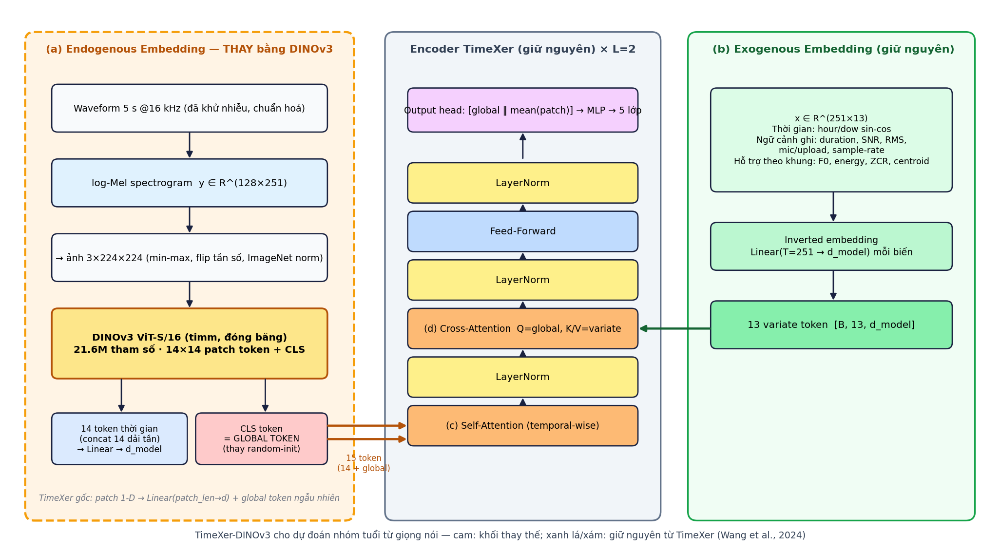
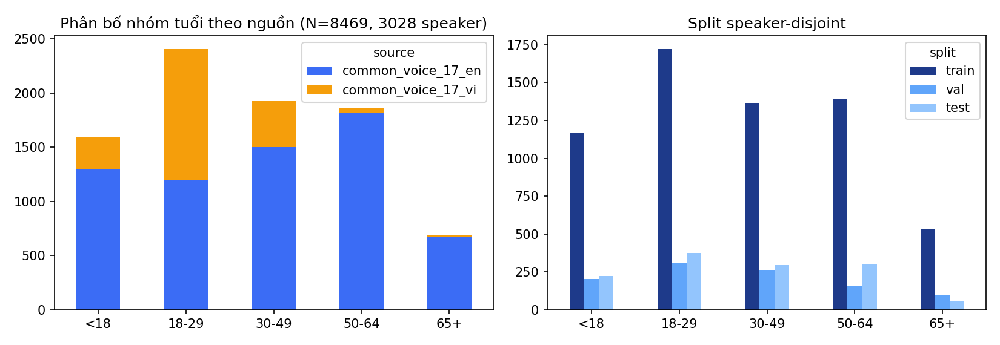
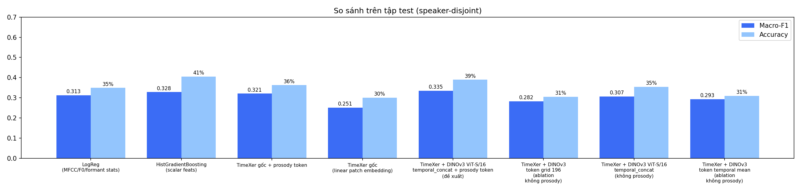
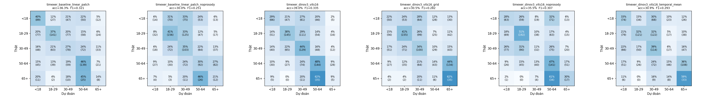
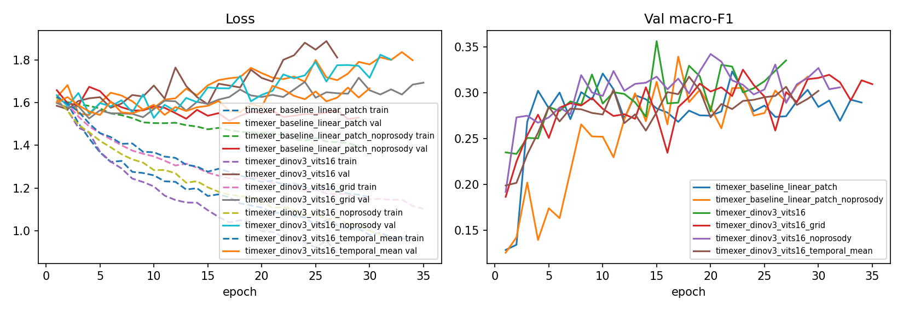
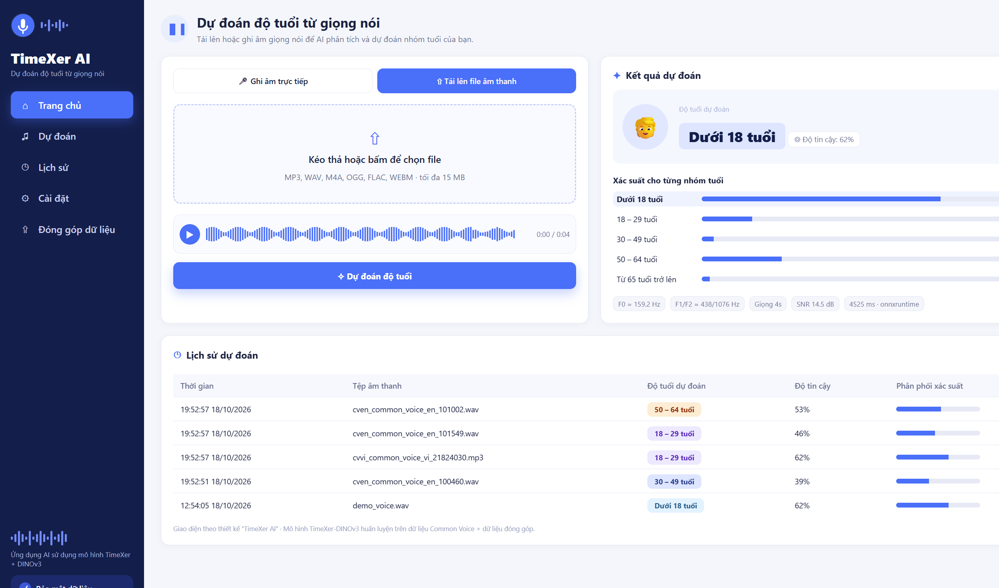
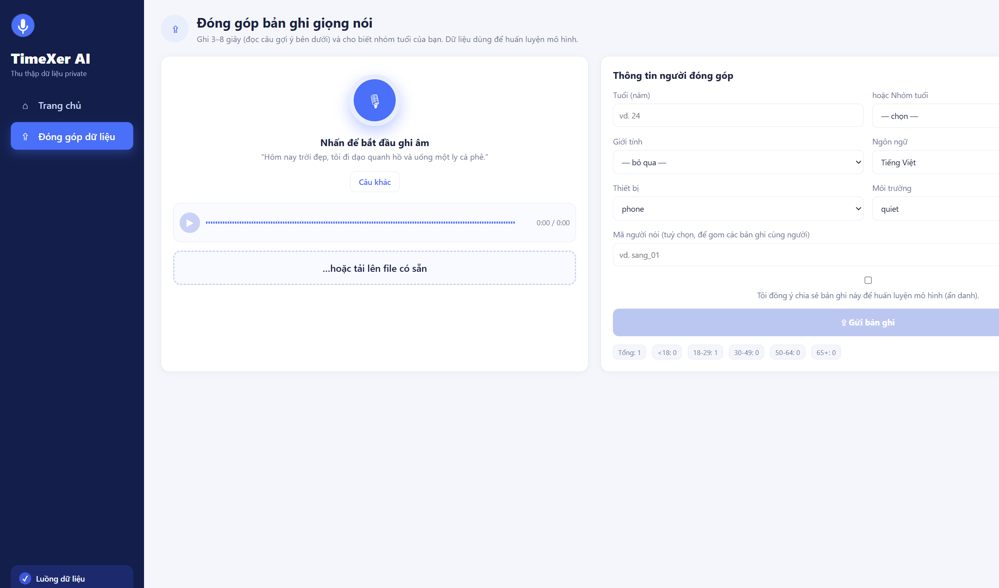

# TimeXer‑DINOv3 — Dự đoán nhóm tuổi từ giọng nói

> **TimeXer** (Wang et al., NeurIPS 2024) với khối *Endogenous Embedding* được **thay bằng DINOv3** (Meta AI, 2025).
> Dự án làm trọn 3 yêu cầu: (1) code thay encoder bằng DINOv3, (2) thu thập dữ liệu theo luồng thiết kế → Kaggle,
> (3) hệ thống web theo bản thiết kế UI kèm mô hình đã xuất → deploy.

| Hạng mục | Nơi xem |
|---|---|
| **(1) Code DINOv3 thay encoder** | [`src/models/dinov3_encoder.py`](src/models/dinov3_encoder.py), [`src/models/timexer_dinov3.py`](src/models/timexer_dinov3.py) — chi tiết tại [§3 Chỗ đã update](#3-chỗ-đã-update-so-với-timexer-gốc) |
| **(2) Dữ liệu (luồng slide 2) → Kaggle** | `scripts/01…03`, `app/frontend/collect.html`, [`scripts/06_package_kaggle.py`](scripts/06_package_kaggle.py) — [§4](#4-thu-thập--xây-dựng-dữ-liệu-slide-2) |
| **(3) Hệ thống (UI slide 3) + model đã xuất** | [`app/`](app/) (FastAPI + UI + Dockerfile), [`scripts/07_export_model.py`](scripts/07_export_model.py) — [§6](#6-hệ-thống-triển-khai-slide-3) |
| Kết quả thí nghiệm | [§5](#5-thí-nghiệm--kết-quả), [`reports/model_comparison.md`](reports/model_comparison.md) |
| Notebook kiểu Kaggle | [`notebooks/timexer_dinov3_voice_age.ipynb`](notebooks/timexer_dinov3_voice_age.ipynb) |

---

## 1. Bài toán & ý tưởng

Đầu vào là một đoạn giọng nói 3–8 s; đầu ra là **nhóm tuổi** của người nói: `<18`, `18–29`, `30–49`, `50–64`, `65+`.

TimeXer là mô hình dự báo chuỗi thời gian có **biến ngoại sinh**: chuỗi nội sinh được cắt patch và học bằng
self‑attention theo thời gian; các biến ngoại sinh được nén thành *variate token* và đưa vào qua cross‑attention với
một *global token*. Ta ánh xạ bài toán giọng nói vào đúng khung này (theo slide 2):

| TimeXer | Trong dự án này |
|---|---|
| Chuỗi nội sinh **y ∈ R^(T×d_y)** | log‑Mel spectrogram 128 × 251 (5 s, 16 kHz, hop 20 ms); MFCC/F0/formant/energy lưu kèm |
| Biến ngoại sinh **x ∈ R^(T×d_x)** | 13 kênh: thời gian ghi (hour/dow sin‑cos), ngữ cảnh ghi âm (thời lượng, SNR, RMS, mic/upload, sample‑rate), tín hiệu hỗ trợ theo khung (F0, energy, ZCR, spectral centroid) |
| (a) Endogenous embedding | **DINOv3 ViT‑S/16** trên ảnh phổ → 14 token thời gian + CLS = global token; thêm **1 prosody token** (51 thống kê MFCC/F0/formant/energy → Linear) |
| (b) Exogenous embedding | giữ nguyên `ExEmbedding` (Linear T→d_model cho từng biến) |
| (c)(d) Self‑/Cross‑Attention, FFN | giữ nguyên `EncoderLayer` |
| Projection (hồi quy T bước, loss MSE) | `ClassificationHead` → 5 lớp, **loss đổi thành cross-entropy có trọng số** (mục dưới) |

Ảnh phổ \(S \in \mathbb{R}^{128 \times 251}\) đi qua DINOv3 (backbone **đóng băng**, không học loss tự giám sát DINO):

\[
I = \mathrm{ImageNetNorm}(\mathrm{Resize}_{224}(S)), \quad
[c;\, P] = \mathrm{DINOv3}(I), \quad c \in \mathbb{R}^{384},\; P \in \mathbb{R}^{196 \times 384}
\]

Token nội sinh (chế độ `temporal_concat`: nối 14 dải tần của cùng một cột thời gian) và global token:

\[
u_t = W_{\mathrm{tok}}\,\mathrm{Concat}_{f}(P_{t,f}) + \mathrm{pos}_t, \quad
g = W_{\mathrm{glb}} c, \quad
h = \mathrm{MLP}(\mathrm{zscore}(p))
\]

\(u_t\) (14 token), \(h\) (prosody) và \(g\) đi vào đúng các lớp Self-Attention / Cross-Attention với biến ngoại sinh của TimeXer. Head đọc \([g \,\|\, \mathrm{mean}(u,h)]\) ra logit \(z \in \mathbb{R}^{5}\).

**Hàm mất mát.** TimeXer gốc tối ưu MSE trên dự báo \(T\) bước. Head phân loại thay projection đó, nên hàm học là cross-entropy làm trơn nhãn, nhân trọng số lớp (\(\alpha = 0.5\), \(\varepsilon = 0.05\)):

\[
w_c = \frac{(N/n_c)^{\alpha}}{\mathrm{mean}_j (N/n_j)^{\alpha}}, \quad
q_k = (1-\varepsilon)\,\mathbf{1}[k=y] + \varepsilon/K
\]

\[
\mathcal{L} = -\frac{1}{B}\sum_{i=1}^{B} w_{y_i} \sum_{k=1}^{K} q_{ik}\,\log \mathrm{softmax}(z_i)_k
\]

Gradient chỉ đi vào phần TimeXer học được (projection token, prosody, ExEmbedding, encoder, head). Tiêu chí chọn checkpoint trên tập val là \(\mathrm{macro\text{-}F1} - 0{,}1\cdot\mathrm{ordinal\text{-}MAE}\), không cộng vào \(\mathcal{L}\). Công thức được cài đúng trong `src/training/loss.py` và kiểm bởi `tests/test_loss.py`.



Bản vẽ thiết kế gốc (từ PPTX): [kiến trúc TimeXer](reports/figures/design_slide1_timexer_arch.png) ·
[luồng dữ liệu](reports/figures/design_slide2_data_flow.png) · [UI](reports/figures/design_slide3_ui.png).

---

## 2. Cấu trúc repo

```
timexer-dinov3-voice-age/
├── src/
│   ├── common/constants.py          # nhóm tuổi, tham số audio, danh sách biến ngoại sinh
│   ├── data/audio_processing.py     # khử nhiễu → cắt/chuẩn hoá → log-Mel, MFCC, F0, formant, energy, exog
│   ├── data/dataset.py              # Dataset/DataLoader, SpecAugment, cân bằng lớp
│   ├── models/layers.py             # ★ TimeXer gốc: EnEmbedding, ExEmbedding, EncoderLayer (KHÔNG đổi)
│   ├── models/timexer_original.py   # ★ TimeXer gốc cho dự báo (tham chiếu)
│   ├── models/dinov3_encoder.py     # ✚ MỚI: DINOv3Encoder thay EnEmbedding (+ MelPatchEmbedding cho ablation)
│   ├── models/timexer_dinov3.py     # ✚ MỚI: TimeXerDINOv3 (phân loại) + TimeXerVoiceBaseline
│   └── training/{loss,trainer,metrics}.py   # loss = weighted label-smoothing CE
├── scripts/
│   ├── 01_seed_common_voice.py      # thu thập seed có nhãn tuổi (Common Voice 17, CC0)
│   ├── 02_ingest_private.py         # nhập bản ghi private từ app /collect hoặc CSV ngoài
│   ├── 03_build_dataset.py          # tiền xử lý + đặc trưng + split speaker-disjoint
│   ├── 04_cache_dinov3_tokens.py    # chạy DINOv3 một lần, cache token (train nhanh trên CPU)
│   ├── 05_train.py                  # huấn luyện / đánh giá
│   ├── 06_package_kaggle.py         # đóng gói + lệnh upload Kaggle
│   ├── 07_export_model.py           # xuất ONNX + model card
│   ├── 08_build_report.py           # bảng so sánh + hình
│   └── 09_draw_architecture.py
├── configs/voice_age_dinov3.yaml    # cấu hình đề xuất (DINOv3 temporal_concat + prosody token)
├── configs/voice_age_baseline.yaml  # ablation: TimeXer gốc (linear patch) + prosody token
├── configs/ablation_*.yaml          # ablation cách gộp token DINOv3 (temporal mean / grid 196 token)
├── app/
│   ├── backend/{main,inference}.py  # FastAPI: /api/predict, /api/history, /api/collect
│   ├── frontend/{index.html,collect.html,app.js,audio-utils.js,styles.css}
│   ├── model/                       # model_card.json, timexer_dinov3_head.pt, timexer_dinov3.onnx (LFS/Release)
│   ├── Dockerfile · requirements-deploy.txt · README_DEPLOY.md
├── notebooks/timexer_dinov3_voice_age.ipynb
├── tests/test_loss.py
├── Dockerfile · render.yaml
├── .github/workflows/{ci,dockerhub}.yml
└── reports/{model_comparison.md, figures/}
```

---

## 3. Chỗ đã update so với TimeXer gốc

Mã TimeXer gốc được giữ nguyên trong `src/models/layers.py` và `src/models/timexer_original.py` để đối chiếu.
Toàn bộ thay đổi nằm ở **2 file mới**:

### 3.1 `src/models/dinov3_encoder.py` — khối (a) mới

| | TimeXer gốc (`layers.py::EnEmbedding`) | TimeXer‑DINOv3 (`DINOv3Encoder`) |
|---|---|---|
| Đầu vào | chuỗi 1‑D `[B, 1, L]` | log‑Mel `[B, 128, T]` |
| Patch | `unfold(patch_len, stride)` → `Linear(patch_len → d_model)` | `MelToImage` → ảnh 3×224×224 → **DINOv3 ViT‑S/16** (`timm: vit_small_patch16_dinov3.lvd1689m`) → lưới 14×14 patch token (384‑d) |
| Gộp token | — | `temporal_concat`: nối 14 dải tần của cùng cột thời gian → 14 token × 5376‑d → `Linear → d_model` (tuỳ chọn `temporal` mean, `grid` 196 token) |
| Global token | `nn.Parameter(torch.randn(...))` khởi tạo ngẫu nhiên | **CLS token của DINOv3** → `Linear → d_model` |
| Vị trí | `PositionalEmbedding` | `PositionalEmbedding` (giữ) |
| Huấn luyện | học từ đầu | backbone **đóng băng** (cache token, `04_cache_dinov3_tokens.py`), có thể mở `dino_freeze: false` khi có GPU |

Đoạn mã lõi:

```python
# src/models/dinov3_encoder.py
def encode_backbone(self, mel):            # mel [B,128,T] -> [B, 1+196, 384]
    img = self.to_image(mel)               # min-max, flip tần số, resize 224, ImageNet norm
    feats = self.backbone.forward_features(img)
    return torch.cat([feats[:, :1], feats[:, self.n_prefix:]], dim=1)   # CLS + patches (bỏ register)

def project(self, raw):                    # phần học được
    cls, patches = raw[:, :1], raw[:, 1:]
    tokens = self.proj(self.pool_tokens(patches)) + self.position_embedding(...)
    return tokens, self.proj_glb(cls)      # (patch tokens, GLOBAL token)
```

### 3.2 `src/models/timexer_dinov3.py` — lắp DINOv3 vào TimeXer

```python
self.en_encoder = DINOv3Encoder(...)        # [THAY] EnEmbedding
self.prosody_embedding = ProsodyTokenEmbedding(n_prosody, d_model)  # [MỚI] 1 token nội sinh từ MFCC/F0/formant/energy
self.ex_embedding = ExEmbedding(seq_len, d_model, dropout)          # [GIỮ] (b)
self.encoder_layers = ModuleList([EncoderLayer(...) for _ in range(e_layers)])  # [GIỮ] (c)(d)
self.head = ClassificationHead(d_model, n_classes)                 # [THAY] FlattenHead -> phân loại
```

`forward(mel, x_ex, prosody)`: `tokens, glb = en_encoder(mel)` → `enc = cat([tokens, prosody_tok, glb])` (global ở
cuối, đúng quy ước `EncoderLayer` dùng `x[:, -1]`) → L lớp TimeXer với cross‑attention tới `ex_embedding(x_ex)` → head.
`forward_from_cache(raw_tokens, x_ex, prosody)` dùng token đã cache để huấn luyện nhanh.

*Prosody token* (`model.use_prosody: true`): 51 thống kê mức clip (`PROSODY_COLS` trong `constants.py`: F0 mean/std/median,
voiced ratio, energy, ZCR, centroid, formant F1–F3, MFCC‑20 mean/std) được z‑score theo train rồi `Linear → GELU → Linear`
thành một token nội sinh — chính là các đặc trưng "MFCC, Pitch, Formant, Energy" trong luồng slide 2. Ablation
`use_prosody: false` (`*_noprosody`) cho thấy đóng góp của token này; baseline TimeXer gốc cũng được cấp cùng token để so
sánh công bằng.

Những thứ **không** đổi: `FullAttention`, `AttentionLayer`, `ExEmbedding`, `EncoderLayer`, `PositionalEmbedding`.
`RevIN` bị bỏ (ảnh phổ đã chuẩn hoá min‑max).

---

## 4. Thu thập & xây dựng dữ liệu (slide 2)

```
Thiết bị vật lý ──Thu thập──▶ Truyền dữ liệu ──▶ Lưu trữ (máy chủ)
   │ điện thoại / laptop / tai nghe            data/raw/private/<id>.wav + <id>.json
   ▼
Tiền xử lý: khử nhiễu (spectral gating) → cắt im lặng & chuẩn hoá 5 s → chuẩn hoá biên độ
   ▼
Xây dựng biến đầu vào:  y = log-Mel [128×251] (+MFCC, F0, formant, energy)   x = [13×251] thời gian + ngữ cảnh ghi
   ▼
Chia train/val/test theo SPEAKER → Huấn luyện TimeXer-DINOv3 → Đánh giá → Thông báo kết quả (UI)
```

* **Thu thập private**: trang `/collect` của app (ghi âm trên điện thoại/laptop, khai tuổi, giới tính, thiết bị, môi
  trường, đồng ý chia sẻ) → `POST /api/collect` lưu audio + metadata; `scripts/02_ingest_private.py` hợp nhất vào
  `data/raw/raw_manifest.csv`. Timestamp thực được dùng cho biến ngoại sinh thời gian.
* **Seed có nhãn** (để khởi động khi dữ liệu private còn ít): `scripts/01_seed_common_voice.py` lấy clip có nhãn tuổi
  từ Mozilla Common Voice 17 (CC0) — tiếng Việt toàn bộ + tiếng Anh cho **mọi** nhóm tuổi (có giới hạn/nhóm) để tránh
  mô hình học "ngôn ngữ = tuổi".
* **Xây dựng**: `scripts/03_build_dataset.py --save-wav` → `data/processed/{metadata.csv, features_scalar.csv,
  mel_logspec.npy, exog_series.npy, audio_16k/, dataset_manifest.json}`.

Thống kê bộ dữ liệu đã dựng (xem `data/processed/dataset_manifest.json`):



**Đưa lên Kaggle (public)** — dataset + notebook "Quy trình thu thập & xử lý dữ liệu"

```powershell
# một lệnh (cần %USERPROFILE%\.kaggle\kaggle.json): đóng gói dataset -> upload -> push notebook
.\kaggle\push_kaggle.ps1 -Username sangvuxuan
# tương đương:
python scripts/06_package_kaggle.py --with-audio --username sangvuxuan   # -> data/kaggle_dataset/ (+ code/, raw_manifest.csv)
kaggle datasets create -p data/kaggle_dataset --dir-mode zip --public
python kaggle/make_data_pipeline_notebook.py && kaggle kernels push -p kaggle/data_pipeline
```

* Dataset: `https://www.kaggle.com/datasets/sangvuxuan/voice-age-timexer-dinov3-vi`
* Notebook pipeline dữ liệu (chạy code thật của `src/data/audio_processing.py`, `scripts/01…03` trên dataset đính kèm):
  [`kaggle/data_pipeline/timexer-voice-age-data-pipeline.ipynb`](kaggle/data_pipeline/timexer-voice-age-data-pipeline.ipynb)
  → `https://www.kaggle.com/code/sangvuxuan/notebookd2bdfc5ac9`

---

## 5. Thí nghiệm & kết quả

Thiết lập: split **speaker‑disjoint** (train/val/test ≈ 70/15/15 theo người nói), CPU Intel i7‑1270P, backbone đóng
băng, AdamW + cosine, class‑weight ∝ (N/n_c)^0.5 + balanced sampler, early stopping theo macro‑F1 (val).
Chỉ số: Accuracy, Balanced‑Acc, **Macro‑F1** (chính), Ordinal‑MAE (khoảng cách nhóm), Within ±1 nhóm.

<!-- RESULTS_TABLE_START -->
Tập test: 1 255 clip / người nói chưa thấy khi train (bảng sinh bởi `scripts/08_build_report.py` → `reports/model_comparison.md`).

| Mô hình | Acc | Bal-Acc | Macro-F1 | Ordinal MAE | Within ±1 | Params học |
|---|---|---|---|---|---|---|
| LogReg (MFCC/F0/formant stats) | 34.9% | 32.1% | 0.313 | 1.050 | 72.9% | - |
| HistGradientBoosting (scalar feats) | 40.6% | 33.2% | 0.328 | 0.910 | 76.6% | - |
| TimeXer gốc (linear patch embedding) | 30.0% | 26.9% | 0.251 | 1.073 | 73.3% | 0.73M |
| TimeXer gốc + prosody token | 36.3% | 32.7% | 0.321 | 1.073 | 69.8% | 0.75M |
| TimeXer + DINOv3, token temporal mean (ablation) | 30.9% | 35.6% | 0.293 | 1.131 | 70.0% | 0.56M |
| TimeXer + DINOv3, token grid 196 (ablation) | 30.5% | 34.8% | 0.282 | 1.112 | 71.3% | 0.56M |
| TimeXer + DINOv3, temporal_concat (không prosody) | 35.5% | 33.3% | 0.307 | 1.039 | 71.8% | 1.20M |
| **TimeXer + DINOv3 ViT‑S/16, temporal_concat + prosody token (đề xuất)** | **39.0%** | 33.6% | **0.335** | 0.944 | 75.5% | 1.22M |

Per‑class F1 (mô hình đề xuất): `<18` 0.32 · `18‑29` 0.44 · `30‑49` 0.38 · `50‑64` 0.46 · `65+` 0.08 (nhóm 65+ chỉ có
~530 clip train, 56 clip test).
<!-- RESULTS_TABLE_END -->





**Nhận xét**

* **DINOv3 thay EnEmbedding giúp TimeXer tốt hơn rõ rệt**: cùng phần (b)(c)(d) và cùng head, đổi khối (a) từ linear
  patch sang DINOv3 tăng macro‑F1 0.251 → 0.307 (không prosody) và 0.321 → 0.335 (có prosody), accuracy 30.0% → 35.5%
  và 36.3% → 39.0%.
* **Cách gộp token quan trọng**: lấy mean theo tần số (`temporal`) hoặc dùng cả lưới 196 token (`grid`) đều kém hơn
  `temporal_concat` (nối 14 dải tần của cùng cột thời gian) — ảnh phổ không đẳng hướng như ảnh tự nhiên, trục tần số
  mang thông tin tuổi (F0, formant) nên không được "trung bình hoá" đi; lưới 196 token lại quá nhiều token cho tập
  dữ liệu nhỏ → overfit.
* **Prosody token** (MFCC/F0/formant/energy ở mức clip — đúng các đặc trưng trong luồng slide 2) bổ sung thông tin
  mà ảnh phổ 224×224 làm mờ đi, giúp cả hai biến thể TimeXer; đây cũng là lý do HGB trên 51 đặc trưng tay vẫn là
  baseline rất mạnh (40.6% acc, nhưng macro‑F1 0.328 < 0.335 vì kém ở nhóm thiểu số).
* Bài toán 5 nhóm tuổi từ 5 s giọng nói của người nói **chưa từng thấy** là bài toán khó (within ±1 nhóm ≈ 75%);
  giới hạn chính là dữ liệu nhỏ, nhãn thập niên thô và backbone đóng băng do train trên CPU.

**Tái lập**

```bash
pip install -r requirements.txt
python scripts/01_seed_common_voice.py                 # seed vi + en
python scripts/02_ingest_private.py                    # (nếu có bản ghi private)
python scripts/03_build_dataset.py --save-wav
python scripts/04_cache_dinov3_tokens.py
python scripts/05_train.py --config configs/voice_age_dinov3.yaml
python scripts/05_train.py --config configs/voice_age_baseline.yaml   # ablation
python scripts/08_build_report.py
```

---

## 6. Hệ thống triển khai (slide 3)

* **Backend** `app/backend/main.py` (FastAPI): `POST /api/predict` (file + nguồn mic/upload + thời điểm ghi) →
  tiền xử lý y hệt lúc train → TimeXer‑DINOv3 (ONNX Runtime; fallback PyTorch) → xác suất 5 nhóm; `GET /api/history`
  (SQLite); `POST /api/collect` + `GET /collect` (thu thập dữ liệu private); `GET /api/model`, `GET /api/health`.
* **Frontend** `app/frontend/` (HTML/CSS/JS thuần, theo bản thiết kế): sidebar TimeXer AI, tab *Ghi âm trực tiếp* /
  *Tải lên file*, waveform + player, nút *Dự đoán độ tuổi*, thẻ *Kết quả dự đoán* (nhóm tuổi, độ tin cậy, thanh xác
  suất 5 nhóm), bảng *Lịch sử dự đoán*. Trình duyệt tự giải mã mọi định dạng → WAV 16 kHz trước khi gửi (không cần
  ffmpeg phía server).
* **Model đã xuất** (`python scripts/07_export_model.py`): `app/model/timexer_dinov3.onnx` (toàn pipeline
  mel + exog + prosody → logits, sai lệch so với PyTorch 2.6e‑5), `timexer_dinov3_head.pt`, `model_card.json`
  (kèm mean/std chuẩn hoá prosody để backend tái tạo đúng đầu vào).

| Trang dự đoán (slide 3) | Trang thu thập dữ liệu (slide 2) |
|---|---|
|  |  |

```bash
# chạy local
pip install -r app/requirements-deploy.txt
uvicorn app.backend.main:app --host 0.0.0.0 --port 7860      # http://localhost:7860

# Docker
docker build -f app/Dockerfile -t timexer-ai . && docker run -p 7860:7860 timexer-ai
```

**Deploy** — xem [`app/README_DEPLOY.md`](app/README_DEPLOY.md): Hugging Face Spaces (Docker), **Render Free** (`Dockerfile` + `render.yaml` ở thư mục gốc), hoặc chạy local cổng 7860.

---

## 7. CI/CD và image Docker Hub

* **CI** (`.github/workflows/ci.yml`, mỗi push/PR lên `main`): chạy `python -m pytest tests/test_loss.py` (đối chiếu \(\mathcal{L}\) với công thức §1) và `docker build` image inference, không push.
* **CD** (`.github/workflows/dockerhub.yml`, push `main` hoặc chạy tay): build `Dockerfile` (ONNX, không PyTorch) và đẩy image **public**
  `docker.io/<dockerhub_user>/timexer-dinov3-voice-age:latest`.

Trên GitHub repo → Settings → Secrets → Actions, thêm `DOCKERHUB_USERNAME` và `DOCKERHUB_TOKEN` (Access Token, quyền Read & Write). Image public thì trên Docker Hub để repo ở chế độ Public.

```bash
docker pull <dockerhub_user>/timexer-dinov3-voice-age:latest
docker run -p 7860:7860 <dockerhub_user>/timexer-dinov3-voice-age:latest
```

## 8. Nộp bài: 3 lệnh cần tài khoản (GitHub / Kaggle / Hugging Face)

Repo đã `git commit` sẵn trên nhánh `main`; model đã xuất; dataset đã đóng gói trong `data/kaggle_dataset/`.
Chạy lần lượt (PowerShell, trong thư mục dự án):

```powershell
# (1) GitHub — code + README + model ONNX (đã nằm trong repo, ~94 MB)
gh auth login
gh repo create timexer-dinov3-voice-age --public --source . --remote origin --push

# (2) Kaggle — dataset public + notebook quy trình dữ liệu
#   tải kaggle.json tại https://www.kaggle.com/settings -> %USERPROFILE%\.kaggle\kaggle.json
pip install kaggle
.\kaggle\push_kaggle.ps1 -Username sangvuxuan
#   -> https://www.kaggle.com/datasets/sangvuxuan/voice-age-timexer-dinov3-vi
#   -> https://www.kaggle.com/code/sangvuxuan/notebookd2bdfc5ac9

# (3) Hugging Face Spaces — hệ thống chạy online (xem app/README_DEPLOY.md)
hf auth login
#   ... các bước clone Space / copy src, configs, app / git lfs / push trong README_DEPLOY.md
#   -> https://huggingface.co/spaces/<hf_username>/timexer-ai-voice-age
```

Sau khi có link, thay 3 placeholder `<...>` trong README này (§4, §6) rồi `git commit --amend`/`git push`.

---

## 9. Tài liệu tham khảo

* Wang, Y. et al. *TimeXer: Empowering Transformers for Time Series Forecasting with Exogenous Variables.* NeurIPS 2024.
* Siméoni, O. et al. *DINOv3.* Meta AI, 2025. Trọng số: `timm/vit_small_patch16_dinov3.lvd1689m` (DINOv3 License).
* Ardila, R. et al. *Common Voice: A Massively‑Multilingual Speech Corpus.* LREC 2020 (CC0).
